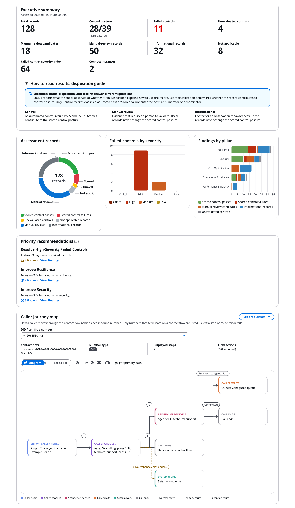
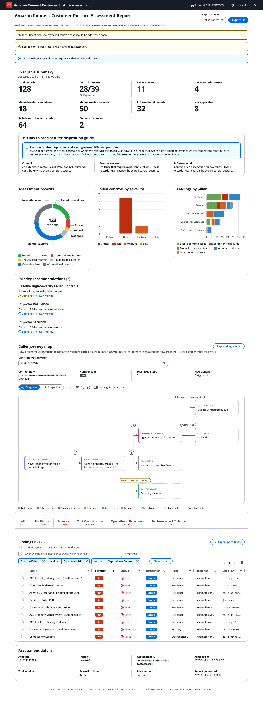
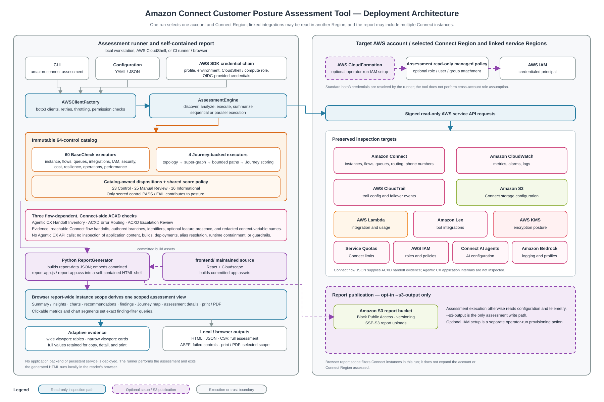

# Amazon Connect Customer Posture Assessment Tool

> Assess Amazon Connect Customer across security, resilience, cost optimization, operational excellence, and performance efficiency using checks informed by AWS Well-Architected best practices.

[](https://www.python.org/downloads/)
[](LICENSE)
[](https://aws.amazon.com/architecture/well-architected/)

A read-oriented-by-default command-line tool that assesses an Amazon Connect Customer
deployment using checks informed by the
[AWS Well-Architected Framework](https://docs.aws.amazon.com/wellarchitected/latest/framework/welcome.html)
and produces a shareable report in minutes. Point it at an AWS account and
region, and it inventories the instance, parses your contact flows, maps what
callers actually experience, and returns prioritized findings with remediation
guidance.

No agents or assessment infrastructure are deployed, and assessed resources are
not modified. See [Security and privacy](#security-and-privacy) for the one
opt-in write path.

```bash
pipx install git+https://github.com/aws-samples/sample-amazon-connect-posture-assessment
amazon-connect-assessment --region us-east-1 --output-dir ./reports
```

---

## Contents

- [What you get](#what-you-get)
- [Sample report](#sample-report)
- [Quick start](#quick-start)
- [Common tasks](#common-tasks)
- [What it assesses](#what-it-assesses)
- [Report formats](#report-formats)
- [Architecture](#architecture)
- [Security and privacy](#security-and-privacy)
- [Documentation](#documentation)
- [Contributing and support](#contributing-and-support)
- [License](#license)

---

## What you get

| | |
|---|---|
| **Caller Journey Map** | Starts from the phone number a customer dials, resolves it to the flow it is actually associated with, performs bounded static path enumeration, and renders an interactive map you can zoom, inspect, and export. Most tooling audits resources; this audits the experience. See [Caller Journey Map](docs/user-guide.md#caller-journey-map). |
| **Contact flow analysis** | Parses published flow content to find dead-end error paths, unreachable blocks, infinite loops, toll-fraud exposure, prompt-injection risk, and Lambda branching with no fallback path — issues that are invisible from the console. |
| **64 canonical controls** | One catalog across all five Well-Architected pillars: 60 BaseCheck executors and 4 Journey-backed executors. Every record carries status, disposition, evidence, and methodology so measured controls stay distinct from review candidates and inventory. |
| **Generative AI coverage** | 9 checks spanning Agentic CX Designer, Connect AI agents (formerly Amazon Q in Connect), and Bedrock. Three Connect-side Agentic CX records inventory the handoff, review escalation intent, and validate error routing without calling Agentic CX APIs or inspecting application internals. See [Generative AI coverage](docs/check-catalog.md#generative-ai-coverage). |
| **Quota headroom** | Concurrent-call and configuration-object utilization against your real Service Quotas ceilings, with a 90-day growth trend projecting how long the current rate leaves before you hit one. |
| **Four output formats** | HTML, JSON, CSV, and ASFF for direct ingestion into AWS Security Hub. |
| **Run-over-run comparison** | `--diff` against a previous JSON report shows what was resolved and what is new, so you can track remediation progress. |
| **Safe by default** | Read-oriented access to assessed resources. The only write path is the opt-in `--s3-output` report upload. |

---

## Sample report

Check out the sample [HTML report](https://aws-samples.github.io/sample-amazon-connect-posture-assessment/examples/sample_assessment_report.html).



<details>
<summary>Show the full report screenshot</summary>



</details>

A complete example is checked in at
[`examples/sample_assessment_report.html`](examples/sample_assessment_report.html) —
open it in a browser to see the report before you run anything. It is built from
the unified 64-control catalog by
[`scripts/generate_sample_report.py`](scripts/generate_sample_report.py) against
synthetic instances. It contains one canonical outcome per control and sample
instance, uses fixed timestamps, and contains no customer data.

---

## Quick start

### 1. Check prerequisites

- **Python 3.12 or later** — `python3 --version`
- **AWS credentials** for the account hosting the Amazon Connect Customer instance
- **Network access** to AWS API endpoints

### 2. Install

```bash
pipx install git+https://github.com/aws-samples/sample-amazon-connect-posture-assessment
amazon-connect-assessment --version
```

The tool installs with [pipx](https://pipx.pypa.io/). See
[Installation](docs/user-guide.md#installation) in the User Guide to install
`pipx`, run from a repository checkout, or use AWS CloudShell.

### 3. Grant read permissions

The tool needs read access to Amazon Connect Customer and a handful of
supporting AWS services. Check whether your current identity already has it:

```bash
amazon-connect-assessment --check-permissions --region us-east-1
```

If permissions are missing, deploy the least-privilege policy template
[`cloudformation/AmazonConnectSelfAssessmentPolicy.yaml`](cloudformation/AmazonConnectSelfAssessmentPolicy.yaml)
and attach it to your IAM role:

```bash
aws cloudformation deploy \
  --stack-name amazon-connect-assessment-permissions \
  --template-file cloudformation/AmazonConnectSelfAssessmentPolicy.yaml \
  --parameter-overrides AttachToRoleName=YOUR_ROLE_NAME \
  --capabilities CAPABILITY_NAMED_IAM \
  --region us-east-1
```

A `pipx` installation does not include the template, so download it first. See
[AWS Access](docs/user-guide.md#aws-access) in the User Guide for the download
command, attaching to an IAM user, and the
[`docs/iam-policy-template.json`](docs/iam-policy-template.json) action list.
The template grants read permissions only; it does not include the S3 write
permissions required by `--s3-output`.

### 4. Run the assessment

```bash
amazon-connect-assessment \
  --region us-east-1 \
  --output-dir ./reports
```

The tool discovers every Amazon Connect Customer instance in the region. To
scope the run to one instance, add `--instance-id <instance-id>`.

### 5. Open the report

```bash
open reports/connect_assessment_*.html        # macOS
xdg-open reports/connect_assessment_*.html    # Linux
start reports\connect_assessment_*.html       # Windows
```

The HTML report is a single self-contained file that is safe to email or attach
to a ticket. The committed React/Cloudscape bundle, fonts, icons, charts,
report data, findings, and journey diagrams are embedded, so the complete
report remains available offline without a CDN or backend service.

---

## Common tasks

| Goal | Command |
|---|---|
| Validate access before a long run | `amazon-connect-assessment --check-permissions --region us-east-1` |
| Validate configuration and probe AWS access without running assessment checks | `amazon-connect-assessment --dry-run --region us-east-1` |
| List the unified controls, executors, severities, and dispositions | `amazon-connect-assessment --list-checks` |
| Assess a single instance | `amazon-connect-assessment --region us-east-1 --instance-id <id>` |
| Focus on one or more pillars | `amazon-connect-assessment --region us-east-1 --pillars security resilience` |
| Report only high-impact findings | `amazon-connect-assessment --region us-east-1 --severity critical high` |
| Run a specific check | `amazon-connect-assessment --region us-east-1 --checks sec-toll-fraud-001` |
| Produce every output format | `amazon-connect-assessment --region us-east-1 --output-format html json csv asff` |
| Compare against a previous run | `amazon-connect-assessment --region us-east-1 --diff ./reports/baseline.json` |
| Publish the report to S3 | `amazon-connect-assessment --region us-east-1 --s3-output` |
| Use a named or SSO profile | `amazon-connect-assessment --profile my-profile --region us-east-1` |
| Speed up a large instance | `amazon-connect-assessment --region us-east-1 --skip-flow-analysis` |
| Troubleshoot with full logging | `amazon-connect-assessment --region us-east-1 -vv --log-file run.log` |

`--dry-run` calls AWS to validate credentials and test a subset of permissions.
It does not execute assessment checks or generate a report.

Checks run in parallel by default. Use `--sequential`, `--max-workers`, and
`--batch-size` to tune throughput, and `--resume-assessment` to continue an
interrupted run. See the [User Guide](docs/user-guide.md) and
[Performance Guide](docs/performance-optimization.md) for the full flag
reference, and the [Configuration Guide](docs/configuration.md) to persist your
options in a YAML or JSON config file.

---

## What it assesses

The unified catalog contains **64 canonical controls**: 60 BaseCheck executors
and 4 Journey-backed executors. The Journey-backed controls are listed with
their owning pillars and appear in `--list-checks`; they are not a separate
findings set.

| Pillar | Canonical controls | Representative coverage |
|---|---:|---|
| Security | 19 | Storage and KMS encryption, CloudTrail coverage, IAM policy inspection, security profiles, approved origins, toll-fraud review, prompt safety, Lex logs, sensitive data, and journey authentication patterns |
| Resilience | 18 | Global Resiliency posture, quota headroom and growth, CloudWatch alarms, Agentic CX error/idle-timeout routing, flow error handling, loop detection, Lambda dependencies, and structural journey dead ends |
| Cost Optimization | 16 | Claimed-number inventory, self-service containment, callback and data-continuity review, idle configuration, operating hours, premium features, model cost, and phone-reachability scope |
| Operational Excellence | 8 | Flow logging, early media, voice fallback, Agentic CX handoff inventory and escalation review, unreachable blocks, Connect AI agents knowledge-base health, and Bedrock invocation logging |
| Performance Efficiency | 3 | Route-aware Lambda inventory, sequential Lambda review, and flow-structure inventory |

Every record has one of three dispositions: 23 `CONTROL`, 25 `MANUAL_REVIEW`,
and 16 `INFORMATIONAL`. Only passed and failed `CONTROL` records enter the
posture score.

Run `amazon-connect-assessment --list-checks` for the live selection, or see the
[Check Catalog](docs/check-catalog.md) for every canonical ID, disposition,
evidence boundary, and verification method, including the
[status and disposition rules](docs/check-catalog.md#status-and-disposition)
and [Generative AI coverage](docs/check-catalog.md#generative-ai-coverage).

---

## Report formats

| Format | Flag value | Use it for |
|---|---|---|
| **HTML** | `html` (default) | Review and hand-off. Single file including the journey map; readable offline. |
| **JSON** | `json` | Automation, custom dashboards, and as the baseline for `--diff`. |
| **CSV** | `csv` | Spreadsheet triage and remediation tracking. |
| **ASFF** | `asff` | Direct ingestion into AWS Security Hub. |

Combine formats in one run and control naming with `--output-filename`, which
supports the `{timestamp}`, `{account_id}`, and `{region}` placeholders. HTML,
JSON, and CSV preserve canonical IDs, disposition, methodology, and the
scored-control numerator/denominator. ASFF exports failed `CONTROL` records
only. See [Report Formats](docs/report-formats.md) for each output contract.

---

## Architecture



The [editable Draw.io source](docs/architecture.drawio) is included.

---

## Security and privacy

- **Read-only against assessed resources.** The tool never mutates the Amazon
  Connect Customer instance, flows, or supporting resources it inspects.
- **Standard credential resolution.** Credentials are resolved through the
  normal boto3 chain and are never written to reports, logs, or checkpoints.
- **Consequential opt-in S3 publishing.** `--s3-output` is the only write path.
  It creates a missing selected bucket or hardens an existing selected bucket
  by applying Block Public Access and versioning and ensuring default
  encryption, then uploads the report. Review the target and permissions before
  enabling it.
- **Reports contain configuration detail.** Findings include flow names, queue
  and routing configuration, and masked phone numbers. Treat generated reports
  as sensitive and store them accordingly.

See the [Threat Model](docs/threat-model.md) for trust boundaries, residual
risks, and hardening recommendations.

---

## Documentation

| Guide | Covers |
|---|---|
| [User Guide](docs/user-guide.md) | Installation paths, AWS access, CLI usage, Caller Journey Map, S3 publishing, run comparison, CI/CD |
| [Configuration](docs/configuration.md) | YAML and JSON settings, precedence, output naming, execution tuning |
| [Check Catalog](docs/check-catalog.md) | All 64 canonical controls, dispositions, methodology, generative AI coverage, executor ownership, aliases, and filter behavior |
| [Report Formats](docs/report-formats.md) | HTML, JSON, CSV, and ASFF output contracts |
| [Performance Guide](docs/performance-optimization.md) | Parallel execution, retry tuning, journey-scoring bounds |
| [Troubleshooting](docs/troubleshooting.md) | Installation, credentials, permissions, runtime, and report issues |
| [Threat Model](docs/threat-model.md) | Trust boundaries, attack surfaces, mitigations |
| [Development Guide](docs/development-guide.md) | Architecture, testing, code quality, adding a check |
| [Documentation Index](docs/README.md) | Full documentation map and source-of-truth rules |

---

## Contributing and support

Contributions are welcome. Start with [CONTRIBUTING.md](CONTRIBUTING.md) and the
[Development Guide](docs/development-guide.md) for project setup, test
execution, and the conventions for adding a check.

- **Something not working?** Check [Troubleshooting](docs/troubleshooting.md)
  first, then open a GitHub issue with the output of
  `amazon-connect-assessment --version` and a `-vv` log.
- **Security issue?** Do not open a public issue. Follow the
  [AWS vulnerability reporting process](https://aws.amazon.com/security/vulnerability-reporting/).

This is sample code published for demonstration and evaluation purposes. It is
not an AWS service and is not covered by AWS Support.

---

## License

Licensed under the MIT-0 License. See [LICENSE](LICENSE).
